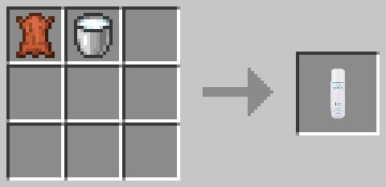
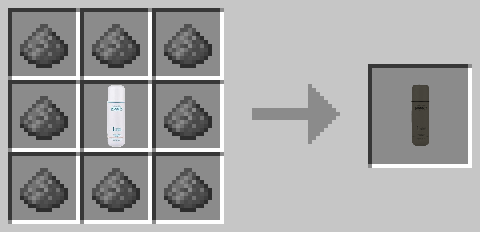

# ProactiveMod 再現アドオン

## 概要

本アドオンは、Shu3様が制作された Minecraft Java Edition（バージョン 1.6.4）向け Mod「Proactive Mod」を、Minecraft Bedrock Edition 向けに再現したアドオンです。

本家 Mod の特徴的な要素を Bedrock Edition で楽しめるよう、独自に再現・調整しています。

## レシピ

### プロアクティブ

### ワルアクティブ

## 使い方・仕様

### プロアクティブ

プロアクティブを投げ、ブロックに着弾させると、着弾地点を基準に上方向のブロックを基本的にすべて整地します。

- **整地範囲：** 横 16 × 奥行き 16 ブロック
- **対象外のブロック：**
  - 岩盤
  - エンドポータルフレーム
  - エンドポータル

### ワルアクティブ

ワルアクティブを投げ、ブロックに着弾させると、着弾地点を基準とした 16 × 16 ブロックの範囲を破壊します。

### ゲームモードによる動作の違い

アイテムのドロップと処理速度は、ゲームモードによって異なります。

| 項目 | サバイバル | クリエイティブ |
|---|---|---|
| アイテムドロップ | 発生する | 発生しない |
| 処理速度 | 負荷軽減のため、処理を段階的に実行 | 比較的高速に実行 |

サバイバルモードでは、アイテムドロップによる負荷を考慮して処理を調整しています。そのため、クリエイティブモードと比べて処理に時間がかかる場合があります。

## 参考リンク

- **本家紹介動画（Shu3様）**  
  https://www.youtube.com/watch?v=GP5gLR6gwgo

- **参考作品（Minecraft Japan Forum）**  
  https://forum.civa.jp/viewtopic.php?t=747

## クレジット

- **原作 Mod 制作：** Shu3様  
  https://x.com/shu33333
- **原作 Mod：** Proactive Mod（Minecraft Java Edition 1.6.4 向け）
- **参考作品制作：** maru2213様
- **参考資料：** 本家紹介動画および Minecraft Japan Forum の配布ページ

本アドオンは、原作 Mod および参考作品を参考に制作したファンメイドの再現アドオンです。原作者様および参考作品の制作者様に感謝いたします。

## 利用規約・ライセンス

本アドオンの公開・再配布にあたっては、使用しているコード・素材の権利関係および参考作品のライセンス条件を確認してください。

参考作品の配布ページにライセンスの記載がある場合は、その条件に従ってください。原作 Mod および参考作品の利用条件は、それぞれの制作者・権利者が定めるものに従います。

- **CC BY-SA 4.0 国際のライセンス全文：**  
  https://creativecommons.org/licenses/by-sa/4.0/deed.ja

※ CC BY-SA 4.0 を本アドオンに適用する場合は、原作 Mod や第三者の素材を含め、そのライセンス条件と矛盾しないことを事前に確認してください。

## 注意事項

- 本アドオンは Minecraft Bedrock Edition 向けです。
- 原作 Mod は Minecraft Java Edition 向けに制作されたものです。
- 本アドオンは原作 Mod そのものではなく、Bedrock Edition 向けの再現作品です。
- 原作者様および参考作品の制作者様が、本アドオンを公式に承認・監修していることを示すものではありません。
- 大規模な整地・破壊処理は、ワールドや端末の状況によって負荷が発生する場合があります。使用する際は十分に注意してください。